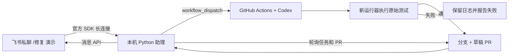

# 飞书个人代码助理：AIHelper

实际验收场景：你在飞书私聊机器人发送 `/修复 演示`，助理触发 `first24/AIHelper` 的 GitHub Actions，Codex 修复一个折扣金额计算错误，原始测试全部通过后创建草稿 PR，并把 PR 链接回报到原飞书会话。你审查后手动合并。



代码已实现真实接口；能否完成线上闭环，以飞书实际收到真实 PR 链接为准。`python -m assistant demo` 仅是离线演练，使用预设补丁和模拟外部通道，不调用模型。

## 1. 准备仓库

目标仓库：https://github.com/first24/AIHelper 。把本目录中的文件放入该仓库默认分支，包含隐藏目录 `.github`；默认分支按 `main` 配置。

在 GitHub 仓库中：

1. Settings → Secrets and variables → Actions → New repository secret，添加 `OPENAI_API_KEY`。模型调用使用该 Key 对应的 API 账户；以该账户可用额度为准。
2. Settings → Actions → General，启用 **Allow GitHub Actions to create and approve pull requests**。组织策略可能由管理员控制。工作流只创建草稿 PR，不执行批准或合并。
3. 允许运行本仓库引用的 Actions。确认 Actions 页能看到 **Feishu code assistant**。
4. 创建一个仅选择本仓库的 fine-grained PAT，用于本机助理：**Actions: Read and write、Contents: Read、Pull requests: Read**。该 PAT 填入本机 `.env` 的 `GH_TOKEN`，无需放入仓库。

`OPENAI_API_KEY` 只配置在 GitHub Secrets；飞书 Secret 和本机 GitHub PAT 只保留在本机 `.env`。发布 PR 使用工作流自己的 `GITHUB_TOKEN`，无需再配置发布 PAT。

## 2. 配置已有飞书应用

需要企业自建应用的“应用机器人”。只有群自定义机器人的 Webhook 地址不能接收本方案的私聊指令。

在 [飞书开发者后台](https://open.feishu.cn/app) 进入你的应用：

1. 添加或启用机器人能力。
2. 权限管理中申请 `im:message.p2p_msg:readonly`（读取用户发给机器人的单聊消息）和 `im:message:send_as_bot`（以应用身份发消息）。
3. 配置应用可用范围包含你；创建版本并发布，按组织流程完成权限审批。
4. 事件与回调中选择 **使用长连接接收事件**，订阅 `im.message.receive_v1`。若后台要求先连接，先完成下一节配置并启动 `discover`，再保存订阅、发布。

这里仅处理私聊文本。电脑需能访问飞书开放平台、GitHub；无需公网 IP、回调域名或内网穿透。

## 3. 本机启动（Windows PowerShell）

在本目录执行：

```powershell
py -3 -m venv .venv
.\.venv\Scripts\python.exe -m pip install -r requirements.txt
Copy-Item .env.example .env
notepad .env
```

若没有 `py` 命令，用 `python` 替换 `py -3`。建议 Python 3.12 或 3.13。

在 `.env` 填写 `FEISHU_APP_ID`、`FEISHU_APP_SECRET`、`GH_TOKEN`，仓库保持 `first24/AIHelper`。先留空 `ALLOWED_OPEN_IDS`。

获取你的飞书 open_id：

```powershell
.\.venv\Scripts\python.exe -m assistant discover
```

私聊机器人发送 `/whoami`，它只会回报发送者自己的 open_id，不会触发 GitHub。把该值填入 `.env` 的 `ALLOWED_OPEN_IDS`，Ctrl+C 结束发现模式。多个授权用户以英文逗号分隔。

然后运行：

```powershell
.\.venv\Scripts\python.exe -m assistant doctor
.\.venv\Scripts\python.exe -m assistant run
```

`doctor` 检查配置是否齐全、仓库和工作流是否可读；不会打印密钥，也无法检查 GitHub Secret 的实际值。`run` 必须保持运行，电脑休眠或进程退出时不能接收指令。长期使用可部署在常在线主机上，保持 `data/jobs.sqlite3` 持久化；同一份状态只启动一个助理实例。

## 4. 真正跑通一次

1. 私聊飞书机器人：`/修复 演示`。
2. 收到任务编号；GitHub Actions 页出现标题 `assistant-<任务编号>` 的运行。
3. 工作流先复现错误：`19.99 × 0.9` 应得 `17.99`，演示代码返回 `18.99`。
4. Codex 修改 `demo_shop/pricing.py`。独立发布任务用干净的原始代码和原始测试验证，只接收修复后的那一个源文件。
5. 5 项业务回归测试及助理服务测试通过，创建 `assistant/<任务编号>` 分支和草稿 PR。
6. 飞书收到真实 PR 链接和“等待你审查合并”。这一步完成才算真实端到端验收。

可用命令：

| 飞书指令 | 行为 |
|---|---|
| `/修复 演示` | 触发预置的订单金额修复任务 |
| `/修复 19.99元打九折应为17.99，请修复` | 把描述传给修复执行器 |
| `/状态 任务编号` | 查询自己的任务状态与运行链接 |
| `/帮助` | 查看指令 |

这是围绕一个真实用例的最小实现：修复范围固定为 `demo_shop/pricing.py`，普通消息会显示帮助，不包含通用聊天、任意仓库修改或微信接入。后续迁移到业务仓库时，同时调整修复范围、测试命令及发布步骤。

演示 bug 在 main 上刻意保留。第一次 PR 合并后该 bug 已修复，再发同一请求可能因无代码变化而不创建新 PR；重复演示时先在单独分支重新引入演示 bug。不要为了重复演示覆盖业务代码。

## 5. 不依赖账号的本地验证

```powershell
python -m unittest discover -s tests -v
python -m assistant demo
```

演练在临时 Git 仓库中复现失败、应用预设补丁、验证通过并创建本地提交，写出 `demo-report.md` 与 `demo-report.json`。它不会修改当前目录的演示 bug，也不会发送真实消息或创建真实 PR。`shop_tests` 在未修复的演示源码上失败是预期现象，常规 main CI 仅运行助理服务测试。

## 6. 故障定位

| 现象 | 检查 |
|---|---|
| 飞书没有收到任何回复 | 机器人可用范围、应用版本是否发布、权限是否审批、事件是否订阅、进程是否在线；先用发现模式 `/whoami` 验证 |
| `/whoami` 有回复，修复没回复 | 正式模式是否启动、`ALLOWED_OPEN_IDS` 是否与本人 open_id 一致；正式模式不处理 `/whoami` |
| GitHub HTTP 401/403 | PAT 是否有效、已选择仓库、Actions 读写权限、组织 SSO/审批 |
| GitHub HTTP 404 | 默认分支上是否已有 `assistant-fix.yml`，仓库名和 PAT 仓库范围是否正确 |
| Codex 失败 | Actions 日志中检查 `OPENAI_API_KEY`、账户额度与模型可用性 |
| 推送成功但 PR 创建失败 | Actions 的 PR 创建开关、组织策略和工作流写权限 |
| PR 的独立 CI 未自动启动 | 工作流内置测试已执行；使用 `GITHUB_TOKEN` 创建 PR 通常不会再触发其他 PR 工作流 |
| 任务等待超时 | 查看 Actions 链接确认是否仍在运行；助理不自动重新触发，避免重复任务 |

SQLite 保存任务、消息去重与终态通知。最多排队 5 个任务，逐个触发。POST 响应丢失时按唯一运行标题找回，不重复派发；进程恰好在标记等待后、请求发出前退出的任务会超时，需人工核对后重发。终态通知失败会继续重试；飞书消息 UUID 用于平台有效期内去重。40 分钟等待超时不会取消已经启动的 GitHub 运行，晚到结果请在 Actions 查看。

## 微信说明

本交付实现飞书入口。微信方向要先确定是个人微信、企业微信还是公众号，三者接口不同。下一步可复用任务引擎和 GitHub 工作流，为选定的官方通道补一个消息适配器；当前代码不声称已经接通微信。

## 参考

- [OpenAI Docs：Codex GitHub Action](https://learn.chatgpt.com/docs/github-action)
- [飞书官方：Python SDK 处理事件 / 长连接](https://open.feishu.cn/document/server-side-sdk/python--sdk/handle-events)
- [GitHub：工作流触发机制](https://docs.github.com/en/actions/how-tos/write-workflows/choose-when-workflows-run/trigger-a-workflow)
