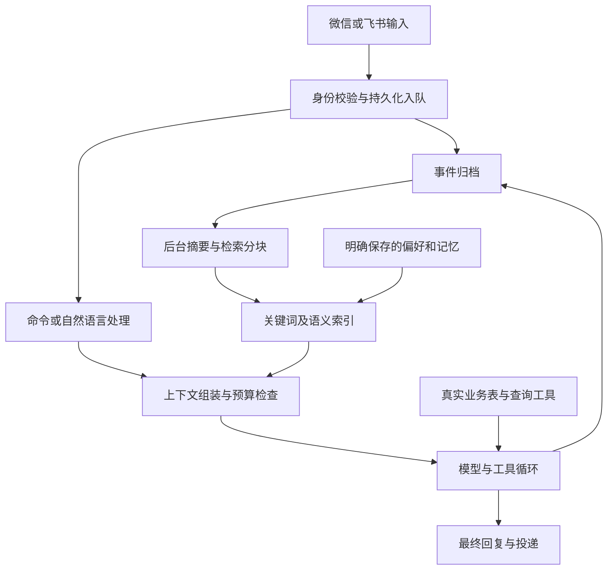

# AIHelper 记忆机制完整改进方案

日期：2026-11-17，Asia/Shanghai。  
文档状态：待实施的技术设计，可作为后续开发任务说明与验收依据。  
本轮交付：仅新增本文档；未修改业务代码、数据库或配置，未运行测试、模型请求、真实工具任务或部署。

## 1. 结论与范围

目标是把当前“最近六轮 + 偏好 + 笔记 + 业务表”升级为：

> 可追溯的事件记录 + 按预算组装的近期上下文 + 有来源的旧对话摘要 + 可管理的长期记忆 + 带权限和时间过滤的混合检索。

“一步到位”指在同一份设计中明确最终行为、数据契约、异常策略、迁移顺序和验收要求；开发仍按依赖顺序分步落地，避免一次切换全部读写路径。不能因为文档完整，就把功能标为已实现。

完整交付应覆盖：

1. 超过六轮后仍可回查允许保留的历史，包含固定命令和完整工具交互。
2. 每次模型请求前按实际模型规则检查输入预算，工具结果追加后重新检查。
3. 较早内容生成结构化摘要，近期内容保留原文，关键事实可回查来源。
4. 长期记忆有明确写入、更新、替代、删除和过期规则。
5. 支持按身份、会话、时间、关键词和语义检索；返回可引用证据。
6. 删除、权限变更和清空上下文不会被旧索引、后台任务或备份回填绕过。
7. 业务状态仍由现有业务表和工具确认；记忆不能授予权限或直接执行操作。
8. 本机 Codex 只接收任务相关的必要背景，不自动共享全部助理记忆。

不包含：训练或微调模型、恢复云端 Codex 迁移、引入通用多 Agent 编排、修改邮件显式发送确认规则、自动部署或自动执行修复。

## 2. 当前事实与源码证据

本轮只读核对：分支 `feature/local-codex-bridge`，HEAD `f83d619646a89b51fee824efd4d70f07e4d5dece`。与面试交接基线相同。工作区已有 `docs/WEIXIN.md` 的修改，以及开发交接、面试交接、学习资料等未跟踪文档；本设计不修改这些文件。

以下为本轮源码核对结果，不是运行验收结果：

| 当前机制 | 实际行为 | 源码入口 |
|---|---|---|
| 短期历史 | 按 owner/chat 读取最近六轮，倒序取出后反转、展开 JSON | `assistant/state.py:176`，`State.history()` |
| 历史保存 | 保存本轮，再实际删除六轮之外的 turns 行 | `assistant/state.py:180`，`State.save_turn()` |
| 请求组装 | system + history + turn；工具定义 SPECS 在请求的 tools 字段 | `assistant/agent.py:22`、`:216`、`:238` |
| 模型限制 | 单次输出上限 2500；最多四次模型请求、八次工具执行尝试；无输入 token 预算器 | `assistant/agent.py:24`、`:244`、`:256` |
| 命令路径 | 多处提前 return，未进入自然语言处理末尾的 save_turn | `assistant/agent.py:135` 起 |
| 清空对话 | 删除当前 owner/chat 的 turns，业务数据保留 | `assistant/agent.py:146` |
| 输入与回复 | messages_v2 存输入、created、最终 reply 和投递状态，不是完整工具轨迹 | `assistant/state.py:82`；`assistant/agent.py:113` |
| 偏好 | owner/key upsert；目前只支持 language/email_signature/brief_style；请求时注入 | `assistant/tools.py:46`、`:360`；`assistant/agent.py:217` |
| 笔记 | owner 隔离；LIKE 查询标题/正文，最多 20 条、正文预览 200 字；可读取全文和更新删除 | `assistant/tools.py:311` 起 |
| 工具分发 | 校验参数；部分写操作保存 effects 结果用于去重 | `assistant/tools.py:54`、`:82` |
| 微信输入 | drain 直接调用 State.enqueue，不经过 Assistant.receive | `assistant/weixin.py:256` |
| 本机 Codex | SQLite 队列 + SSH RPC + 本机独立会话/worktree；任务说明不自动附带聊天历史 | `assistant/codex_jobs.py:24`、`:90`；`assistant/local_codex.py:132`、`:182` |

此前 101 项通过是工程测试的历史记录。本轮未重跑，不能作为本方案的验收结果，更不能作为模型理解、记忆召回或回答准确率。

## 3. 术语与基本原则

| 术语 | 本设计中的含义 |
|---|---|
| 事件 | 一条用户消息、模型工具调用、工具结果、最终回复或明确的控制操作 |
| 轮次 | 从一条用户输入开始的一次完整处理，可包含多次模型与工具交互 |
| 会话 | 由后端身份和聊天标识确定的一段连续上下文 |
| 记忆 | 被明确保存、可跨轮或跨会话使用的偏好、事实、事件或决定 |
| 摘要 | 对旧事件的有损整理，必须有覆盖范围和来源 |
| 检索 | 从允许访问的记录中找出与当前问题相关的证据 |
| embedding | 把文本转换成表示语义的数值向量，用于相似内容查找 |
| 派生数据 | 从原记录生成的摘要、检索分块、向量等，可失效和重建 |
| 版本校验 | 写入前确认读取时的记录没有被其他操作更新 |

必须成立的约束：

- 历史不等于当前业务状态；“曾创建成功”不证明“现在仍有效”。
- 用户意图、建议、执行请求、工具成功、工具失败、结果未知必须分开保存。
- owner/chat 等身份来自后端，不由模型参数决定。
- 被删除或撤销访问的数据，不能因摘要、向量或重建任务再次进入上下文。
- 工具调用与对应结果保持关联；一条 assistant 消息可以请求多个工具。
- 记忆、摘要、网页和邮件均是数据，不得升级为系统规则或新的执行授权。
- 不记录模型隐藏推理；只保存应用实际收到的公开响应、工具交互和必要执行元数据。

## 4. 最终架构与实现选择

继续使用 SQLite 作为权威存储，不为个人助理立即增加独立消息队列或远程向量数据库。后台派生任务使用 SQLite outbox：业务提交时写入待处理记录，由后台执行器处理并重试。



建议新增模块，名称均为设计名称，当前不存在：

| 模块 | 职责 |
|---|---|
| `assistant/memory_store.py` | 会话、事件、长期记忆、来源、删除和版本的数据库操作 |
| `assistant/memory_context.py` | 选择近期交互、加载摘要、组装证据、预算检查 |
| `assistant/memory_search.py` | 权限过滤、时间解析、关键词/语义召回、融合排序 |
| `assistant/memory_jobs.py` | 摘要、分块、向量、失效清理的后台任务 |
| `assistant/memory_tools.py` | 对模型开放的有限查询和记忆管理接口 |
| `assistant/memory_types.py` | 数据契约、枚举和结果结构校验 |
| `assistant/migrations/` | 有版本号、可重复检查的数据库迁移 |

不要把全部逻辑塞进现有 `State` 或 system prompt。`State` 保留数据库连接与事务入口，新模块使用它提供的受控操作。

## 5. 身份、会话与可见范围

### 5.1 身份与会话键

- 当前继续以经过授权校验的 owner 为用户边界。
- 会话查找键为 `(owner, chat, epoch)`；`epoch` 表示一次上下文周期。
- `session_id` 使用应用生成的稳定 ID，与 Codex 的 session_id 区分命名；代码中使用 `memory_session_id`。
- 会话隔离与长期记忆共享分开：近期历史默认仅当前会话；明确保存的 owner 级记忆可以用于该 owner 的其他会话。
- 微信当前把绑定账号映射到已授权 owner；不读取私有配置来推断其他账号关系。
- 新增跨渠道账号时，必须通过可信配置或验证流程关联同一身份，禁止按昵称自动合并。

### 5.2 范围与默认行为

| 数据 | 默认可见范围 |
|---|---|
| 近期原文和滚动摘要 | 当前 owner/chat/epoch |
| 明确保存的长期偏好 | 当前 owner |
| 普通任务暂存状态 | 当前会话；显式指定项目范围另行设计 |
| 历史事件归档 | 当前会话自动检索；用户明确回溯往事时，可检索本人允许的其他会话 |
| 业务记录 | 沿用现有业务表的权限检查 |

跨会话历史只有被问及、或与当前任务存在明确且可解释的关联时才召回，不能把用户所有会话全文默认注入。

## 6. 数据结构与索引

以下是实施契约，不是已经执行的 DDL。所有时间统一存 UTC 时间戳，展示和相对时间解析使用用户时区。文本字段需要长度上限，JSON 需要结构校验，外键需要显式启用并迁移验证。

### 6.1 权威记录

| 表 | 关键字段与约束 |
|---|---|
| `memory_owner_state` | `owner` 主键、`generation`、`memory_version`；generation 在遗忘/权限收紧时递增 |
| `memory_sessions` | `id` 主键、owner、chat、epoch、revision、last_seq、created_at、closed_at、auto_recall_enabled；唯一 `(owner,chat,epoch)` |
| `memory_turns` | `id` 主键、session_id、input_message_id、first_seq、last_seq、status、received_at、completed_at、trace_completeness；唯一 `(session_id,input_message_id)` |
| `memory_events` | `id` 主键、owner、session_id、turn_id、seq、event_key、role、kind、payload_json、tool_call_id、recorded_at、event_at、source_type、source_id、trust_level、visibility、generation；唯一 `(session_id,seq)` 和 `event_key` |
| `memory_items` | `id` 主键、logical_key、version、owner、scope、scope_id、kind、claim_type、content_json、status、valid_from、valid_until、recorded_at、supersedes_id、generation |
| `memory_sources` | 派生对象/记忆与来源之间的关系；字段见下文 |

约束说明：

1. `memory_turns.status` 为 processing/completed/interrupted/failed；处理完成不等于回复已经投递。
2. `trace_completeness` 为 full/partial/legacy_final_only，防止把迁移记录冒充完整轨迹。
3. `event_key` 由输入消息 ID、模型步骤、调用 ID/序号及事件类型构成，重试不得产生重复事件。不同平台输入 ID 要保留平台命名空间。
4. 同一会话的 seq 在数据库事务内分配，代表应用记录顺序；不能用客户端不可信时间决定覆盖顺序。
5. `kind` 区分 preference/fact/event/decision；业务当前状态不复制成可覆盖业务表的 fact。
6. `claim_type` 区分 user_explicit/user_proposal/tool_observed/assistant_inference/imported。assistant_inference 不自动作为确认事实生效。
7. `status` 为 candidate/active/superseded/deleted/expired；同一 `(owner,scope,scope_id,logical_key)` 只允许一个 active 版本，用部分唯一索引约束。
8. `scope` 首版只允许 owner/session；scope_id 不为空，owner 级也使用规范化值，避免 NULL 导致唯一约束失效。
9. 编号、金额、时间和业务 ID 从真实输入或工具结果复制，禁止由摘要或记忆提取模型编造。

`memory_sources` 必须表达多来源关系，不能只保存一条 source_id：

```text
derived_kind, derived_id,
source_kind, source_id, source_version,
source_owner, source_session_id, source_seq,
relation, created_at
```

source_kind 可为 event/note/preference/business_snapshot/user_confirmation。删除来源时保留最小墓碑标识供失效清理，不保留已经要求删除的正文。删除依赖既要包含来源引用，也要包含摘要实际读取的覆盖范围，不能只依赖模型主动列出的引用。

### 6.2 可重建派生记录

| 表 | 关键字段与约束 |
|---|---|
| `memory_summaries` | id、owner、session_id、from_seq、upto_seq、source_revision、generation、schema_version、content_json、status、created_at、model_id；范围仅覆盖完整已结束轮次 |
| `memory_segments` | id、owner、scope、scope_id、session_id、source_type、source_id、source_version、from_seq、upto_seq、text、event_at、recorded_at、status、generation、content_hash |
| `memory_embeddings` | segment_id、provider、model、dimension、vector_version、content_hash、vector_blob、status；组合主键包含模型版本 |
| `memory_jobs` | id、owner、kind、source_id、source_version、generation、status、attempts、retry_at、lease_until、error_code；任务键唯一，避免重复生成 |
| `memory_tombstones` | owner、target_type、target_id/logical_key、generation、deleted_at、reason_code；不保存被删正文 |

推荐索引：

```text
memory_sessions(owner, chat, epoch)
memory_events(owner, session_id, seq)
memory_events(owner, event_at, id)
memory_turns(session_id, completed_at, id)
memory_items(owner, scope, scope_id, status, kind)
memory_sources(source_kind, source_id, source_version)
memory_sources(derived_kind, derived_id)
memory_summaries(session_id, status, upto_seq)
memory_segments(owner, scope, scope_id, status, event_at)
memory_jobs(status, retry_at, lease_until)
```

跨表引用校验来源 owner；不能只凭全局 ID 读取正文。对 note、preference 等既有记录补充可追踪版本，或者在同一事务写入独立 source revision 表。

generation 是防止旧任务提交的栅栏，不是“只有 generation 等于当前值的所有历史才可读”。一次遗忘后，未受影响的旧事件仍可使用；读取检查具体来源可见性、墓碑与派生依赖，后台任务则比较启动时与提交时的 owner generation，发生变化就重新计算。

## 7. 写入链路：覆盖全部入口和中断情况

### 7.1 输入归档

共同入口放在 `State.enqueue()` 的持久化事务附近，覆盖飞书 receive 与微信 drain。不能只在 Assistant.receive 中记录，否则漏掉微信。

同一事务内完成：重复消息检查、入队、会话定位、用户输入事件写入。原始事件指应用收到并经过必要敏感处理的内容，不承诺保存未经处理的所有字节。

模型每次请求前只记录步骤和引用的上下文清单，不重复保存整份组装 prompt，以免同一段历史无限复制。可记录 schema 版本、来源 ID、预算统计与内容摘要哈希；不要写入请求鉴权头。

### 7.2 自然语言工具轨迹

1. 模型返回后，校验公开响应并记录 assistant 消息。
2. 调用工具前，记录工具名、参数、调用 ID 和 planned/started 状态。
3. 工具返回后，立即保存结果事件，不等待最终模型回复。
4. 最终回复记录为 final 事件；将 turn 标记为结束。
5. 同一事务放入摘要/索引 outbox，后台失败不能撤销已成功的业务操作。

工具返回可能很大：建议普通事件 JSON 硬上限初始为 256 KiB，模型可见预览远小于归档上限。超限使用受控 payload 存储或分块；若只能保留引用，标记 full_payload_available=false，明确不能完整重放。临时网页 URL 不等同于可复现快照。

不将 SMTP、日历 API 等外部调用放在数据库写事务中。也不能把“已记开始事件”误认为“操作没执行就可以重跑”。发生“副作用已完成、事件保存失败”时，用业务记录/effects/外部核查恢复状态；无法确认则记 unknown，不自动重做。

### 7.3 固定命令与直接执行路径

在 `Assistant.tick()` 处理边界统一建立与结束 turn，避免各提前 return 遗漏最终回复。`Tools.execute()` 的公共执行边界统一记录结构化工具结果；对 `/发送邮件` 等直接业务调用，额外记录明确操作回执。

固定命令不是模型 tool_calls：使用 kind=command_result 记录，不伪装成没有对应 assistant 请求的 role=tool。回放到模型时转换成带来源标记的历史资料块。

邮件、网页、代码任务等大正文采用引用和预览；记录谁要求执行、是否确认、执行结果，不主动扩大归档或长期记忆的敏感数据范围。

### 7.4 崩溃与恢复

- 重启把未结束 turn 标为 interrupted，不伪造最终成功。
- 对只有开始、没有结果的工具记录，标为结果未知；查询业务状态，不自动重放写操作。
- 归档可保留不完整轨迹，但直接放入 API 的历史必须验证消息协议；不完整工具组转换为有来源的状态说明，不能把孤立 tool 消息原样发送。
- 回复发送失败只重试投递，不重新执行模型和业务工具。
- 记忆任务只重试摘要、索引等派生计算，不调用提醒创建、发信或代码修复工具。

## 8. 长期记忆的写入、更新与冲突

### 8.1 何时写入

明确要求“记住我喜欢简短回答”，可以保存偏好。普通对话提到“这次简单说”，只对当前轮生效，不自动覆盖长期偏好。

首版采用确定性优先策略：

1. 现有 notes、preferences 仍是各自领域的权威记录，不复制成另一套可独立编辑的值。
2. 记忆检索层对它们建立带版本的索引和来源关系。
3. 新增长期事实/决定必须源于用户明确保存意图；模型可以生成候选，但候选不自动注入为确认事实。
4. 从网页、邮件、Issue 中提取的信息不能成为用户偏好或授权。引用它们时保留外部来源类型。
5. 默认不保存密码、API Key、授权码、SSH 私钥或 Codex 登录信息。检测只是辅助，不能承诺正则能识别所有秘密；不新增读取这些配置的路径。

不引入“模型感觉很重要就永久保存”的默认机制。

### 8.2 更新与版本

更新采用 compare-and-swap：客户端提交 expected_version，数据库确认仍是该版本后，在一个事务中停用旧版本、写新版本及来源、创建索引更新任务。版本冲突返回最新记录，不覆盖用户刚完成的修改。

偏好逻辑键尽量规范化，例如 language、brief_style；不得由模型随意新增与规则重名的键。继续兼容现有三个 preference key，再通过显式迁移扩展。

“明天改成四点”需要拆成用户意图与工具结果；仅当工具确认时记录该次执行成功。“新记录较新”不足以证明更可信：提议不能覆盖已确认决定，模型推断不能覆盖工具证据。

当前偏好作为用户数据加载，禁止覆盖系统规则。检索中的旧版本只可用于回答“以前是什么”，不能误用为当前偏好。

## 9. 上下文组装与 token 预算

### 9.1 请求结构

模型输入建议保持如下逻辑结构，具体消息角色按供应商接口要求适配：

```text
可信 system：行为规则、时间、时区、工具使用边界
用户数据区：有效偏好、结构化任务状态（附来源与适用范围）
旧摘要资料区：明确标记为历史资料
检索证据区：编号、时间、来源、内容、执行事实类型
近期完整交互：保留正常的 user/assistant/tool 顺序
当前轮：用户输入及本轮追加的交互
工具定义：与当前实际开放工具一致
```

资料区不是新的系统指令。摘要不得伪装成用户刚发出的确认，也不能作为发信、部署等操作的授权。

### 9.2 容量与计数

新增模型能力配置：model_id、context_limit、max_output、tokenizer_id、counter_version、safety_margin。具体上下文容量按选定模型实际接口确认，本文不编造 DeepSeek 当前容量。

初始输出上限可保持现有 2500；安全余量建议从 max(1024, 上下文容量的 5%) 起评估，属于待测参数。应用可设置低于模型容量的成本上限，不能把应用上限当成模型官方容量。

```text
完整输入 token + 输出预留 + 安全余量 <= 已确认的上下文容量
```

完整输入包括 system、工具 schema、消息角色/协议开销、偏好、摘要、证据、历史和当前轮。每次 `model.complete()` 前检查，包括工具返回后。

必须使用经过适配验证的 tokenizer 或供应商计数能力；不能假设其他模型的 tokenizer 适用。若只能估算，记录 count_quality=estimated，采取保守上限并处理服务端超限，不能声称有精确容量保证。完整预算验收要求计数方案和模型能力已确认；未确认时保持该能力未验收，不伪造官方数字。

### 9.3 分配与超预算顺序

1. 优先保留可信规则、当前问题、已执行动作的真实结果、关键约束和待解决事项。
2. 近期目标默认六个完整已结束轮次，但以实际 token 预算为准，不保证始终六轮。
3. 剩余预算分配给摘要和证据；先少量候选，需要时再读取全文。
4. 超预算先移除无关或重复证据，再减少旧轮次，再缩短摘要。
5. 工具结果先解析、选字段、分页或给引用，不按字符切断 JSON。
6. 工具调用和结果以完整交互组保留或移除，不能制造孤立消息。
7. 当前轮也可能过大；允许将已结束的工具交互转换为有来源的紧凑事实块，但必须保留业务编号、真实成功/失败/未知结果及必要约束。原轨迹独立归档。
8. 必要信息仍放不下时停止新的动作，向用户说明需要缩小范围或拆任务。不得静默删除关键约束，也不得因重试重做已完成副作用。

长工具结果的模型可见结构建议包含 items、total/has_more、source_refs、omitted_fields、full_read_handle。每个结果适配器独立确定必需字段，不能使用统一“前 1000 字”规则。

## 10. 摘要协议、生成与并发提交

### 10.1 输出结构

```json
{
  "schema_version": 1,
  "goals": [],
  "constraints": [],
  "confirmed_decisions": [],
  "entities": [],
  "observed_actions": [],
  "pending": [],
  "uncertainties": [],
  "source_refs": []
}
```

每项包含必要来源引用。observed_actions 区分 succeeded/failed/unknown；entities 保留真实编号与绝对日期。目标“把提醒改到四点”不能转写成“四点修改成功”。

例：以下完全是假设数据，不是运行记录。

```text
用户要求：把提醒 r_example 改到 2026-11-20 16:00 +08:00，不新建。
工具结果：修改失败。
摘要：目标时间为上述时间；本次修改失败；不重复创建；当前状态需查询。
```

摘要生成调用禁用工具，不接触业务写接口；模型只得到需覆盖的获准事件，不得到密钥或完整无关记忆。

### 10.2 生成与提交

1. 选取已结束且不在近期窗口的完整轮次，读取范围、session revision 和 owner generation。
2. 在数据库事务外调用摘要模型。
3. 校验 JSON 结构、大小、来源存在性、编号是否来自原文，拒绝无来源的新业务 ID。
4. 短事务检查 generation、来源可见性、版本及覆盖区间是否仍有效。
5. 检查通过后激活摘要，并替换旧摘要；否则丢弃或重新排队。

首版选择保守并发策略：session revision 有变化则不激活该候选，重新排队；频繁交互时继续使用旧摘要与近期原文，不阻塞用户。未来可在证明覆盖范围未变化后允许追加式提交。

`upto_seq` 只覆盖最后一个完整轮次。上下文读取使用同一快照，避免摘要已覆盖某轮、原文又重复包含该轮，或两者之间出现空洞。保存 watermark 只代表已摘要覆盖，不代表可以立即删除原始记录。

避免无限摘要的摘要：按完整事件组生成有限长度分段摘要，滚动总摘要从原分段及必要原文重建；保留模型版本和来源。摘要失败时保留旧有效版本，未覆盖原文按预算保留；放不下则明确说明缺失并按需检索。

## 11. 跨会话与时间检索

### 11.1 两阶段读取

设计两个接口：先找候选，再读原文，避免一次返回所有历史。

```text
search(query, scope, time_range, kinds, limit, cursor)
  -> hits[{id, snippet, source, event_at, claim_type}], has_more, coverage

read_evidence(ids, cursor)
  -> authorized source excerpts, versions, provenance, completeness
```

owner、当前 chat、可访问 session 集由后端注入。模型即使知道其他记录 ID，也不能绕过 read_evidence 的二次权限检查。scope 默认 current_session；扩展到 owner_history 必须符合当前用户请求和后端策略。

### 11.2 查询路径

1. 明确对象与意图：问“当时为什么”查历史，问“现在怎样”优先业务工具。
2. 解析时间范围：昨天、上周按用户时区转换成 UTC 半开区间 `[start,end)`；区分 recorded_at 与事件实际 event_at。
3. “前几天”不能固定解释成某个精确天数。可先查近期候选，标明实际搜索范围；不够再扩大或澄清。
4. 在数据库层筛 owner、scope、active/visible、会话自动召回开关、墓碑、时间等条件；同一查询使用一致的权限快照。
5. 并行取得关键词与语义候选，去重并融合排序。
6. 对前若干候选读取原文，校验最新可见性和来源版本，再放入上下文。
7. 回答带日期、来源编号或原会话位置；没有证据时不编造“你以前说过”。

建议默认返回 5 条候选、最大 20 条，单条先给短预览；这些是可调参数，不是已验证的最优值。重排综合词匹配/语义分数、来源类型和时间，不以更新时间较新作为唯一可信度依据。

### 11.3 关键词与中文支持

精确 ID、邮箱、日期和明确关键词优先 SQL。起步沿用参数化 LIKE，并对 `%`、`_`、反斜杠转义；owner/时间索引先收窄范围。中文关键词使用子串匹配，并可生成受控的中文二元/三元词片段辅助匹配。

不假设 SQLite 默认 FTS 分词适合中文，也不假设环境必有 FTS5/trigram。若引入 FTS，先探测构建能力、明确中文分词方案，再通过基准用例比较。关键词路线始终保留，防止 embedding 不可用时完全失忆。

### 11.4 语义向量实现

本设计选择可替换 EmbeddingProvider 接口，数据仍存 SQLite：

- provider 输入仅为允许建立索引的分块，不发送全部数据库。
- 可接本地模型或经用户配置的数据处理服务；本轮不选择或调用实际服务，也不读取凭证。
- 现有 DeepSeek 聊天接口不等于已配置 embedding 服务，不假设存在可用的向量模型。
- 首版使用 SQLite 保存向量与模型元数据，应用层对已授权候选计算相似度；先按权限过滤再计算，不在全库相似搜索后才过滤。
- 向量分批计算，验证维度、有限数值、内容哈希和版本；不得混用不同模型空间的向量分数。
- 使用排名融合，例如按两路排名的倒数相加；避免把不可比较的原始分数直接相加。
- 配置最大扫描候选数和耗时。超过上限时采用时间分段/扩大搜索，并返回 coverage=partial，不能把截取近期候选后的漏检说成“没有历史”。
- 数据量增长且基准证明瓶颈后再更换专门向量索引。存储迁移不改变权限、来源、删除与版本契约。

分块按话题或完整事件组，不跨 owner。超长网页可拆正文片段，但检索片段是带来源的资料，不直接当作原始 role=tool 回放。

语义组件未配置时允许关键词降级，但应显示 semantic_available=false；完整“混合检索”能力不能在此情况下标为验收通过。

## 12. 工具与用户可见操作

下列是拟新增接口，名称可在实现中按命名约定调整。必须同步扩充 SPECS、后端 validate、工具路由和只读/写入分类，不能只改 prompt。

| 接口 | 行为与限制 |
|---|---|
| `search_history` | 本人允许范围内搜索历史，支持时间和会话筛选 |
| `read_history_evidence` | 按真实证据 ID 读片段，二次权限和版本检查 |
| `list_memories` / `get_memory` | 查看生效记忆及来源、版本和范围 |
| `save_memory` | 仅保存明确要求的长期事实或决定；不接收 owner 参数 |
| `update_memory` | 使用真实 ID 与 expected_version；不默默覆盖冲突 |
| `forget_memory` | 删除目标记忆和相关派生影响，返回实际完成状态 |

现有 notes/preferences 工具兼容保留。新旧接口不得形成两套可独立修改的权威值；对偏好的通用记忆更新实际路由到偏好版本写入路径。

遗忘接口也必须尊重权威来源：删除偏好要同步删除或停用其 preferences 权威值，不能只删检索副本；普通笔记的“停止用于记忆”与“删除笔记原文”分别处理，回执说明原文是否保留。前者设置持久的来源排除标记，防止后台全量重建再次收录；后者调用统一的笔记删除及派生失效路径。

现有 `Tools.execute()` 按名称前缀粗略判断缓存，需要调整：不能让 search_history/read_history_evidence 被当成写操作缓存到 effects。未来采用显式工具元数据 `read_only`、`cache_policy`、`mutation_kind`；对遗忘接口不缓存含被删正文的结果，只保留最小回执。

用户说“忘记那个事”而匹配多个对象时，先列候选澄清。涉及跨来源整段遗忘时先给出范围预览，由用户指定目标后执行；不通过模型自由生成删除 SQL。

### 12.1 清空上下文与删除记录的区别

建议明确区分三个操作，并更新帮助与回执：

| 操作 | 设计行为 |
|---|---|
| `/清空对话` | 切换当前 chat 的 epoch，清近期缓存，旧摘要不再注入；旧周期记录不参与任何会话的自动检索；长期偏好、笔记与业务数据保留 |
| 显式查询已清空历史 | 用户明确要求查看旧周期时才可访问获准归档；必须说明清空上下文没有删除归档 |
| 删除会话记录/忘记指定记忆 | 按明确范围删除或阻止重用来源，并同步处理派生数据；业务对象不因此取消或删除 |

当前 `/清空对话` 只删除 turns。新增归档后，不能仍用模糊的“全部清除”回执；必须说明上下文重置、归档删除和业务删除是不同操作。命令自身只写最小控制事件，不把清空前正文复制到新周期。

## 13. 删除、保留期限与防止再次召回

### 13.1 遗忘事务与异步清理

1. 校验 owner、真实目标 ID 和删除范围。
2. 同一事务将目标及相关来源设为不可用于记忆，递增 owner generation，写墓碑。
3. 同步失效依赖摘要、分块及索引记录，清理可注入的缓存；此时开始禁止读取旧内容。
4. 后台物理删除正文、向量、可删除 payload，完成后更新删除任务状态。
5. 所有后台任务提交时检查 generation、墓碑和来源版本，拒绝删除前生成的过期结果。
6. 回执区分“已停止使用，物理清理中”和“清理完成”，不能提前承诺彻底抹除。

遗忘一条长期记忆时，要删除该 logical_key 的历史内容版本，并阻止原来源再次被自动抽取或召回为相同记忆。来源事件仍含该事实时，保守地将相关完整交互组排除出自动记忆读取；若用户要求删除原文，则按预览确认的范围清理。用户日后明确重新提供同一事实，可作为新来源重新保存。

删除笔记时同步失效其全文索引、摘要引用和内容副本。旧摘要只要读取范围含被删来源，即使没有主动引用该条，也必须失效重建。

### 13.2 既有副本与业务数据

正文可能存在于 messages_v2.text/reply、effects.result、通知正文、笔记、任务结果或本机工作记录。开发时建立“副本清单”，按删除范围逐项处理，不能只删新 memory_items。

- 对消息归档删除，可在不破坏消息去重/投递状态的前提下，清除对应 messages_v2 文本和已无用途的通知正文。
- effects 中保留执行去重所需的最小结果标识；需要清除正文时改为安全的结果引用，不简单删掉记录诱发重复副作用。
- 业务表的邮件、提醒等不因清空上下文自动删除；显式业务删除仍走各自工具。
- 本机 Codex 会话和工作目录是独立产物。云端遗忘不等于删除本机记录；删除回执必须列出尚未覆盖的范围，不能暗示已远程擦除。

### 13.3 保留与备份

建议初始策略：普通事件归档 90 天；大体积外部正文 payload 7 天；明确长期记忆、笔记和偏好保留至修改、过期或删除。这是待实施产品策略，不是当前行为，也不是无限保存全部聊天。

到期删除来源时，依赖它的自动摘要和索引一并失效。若一条事实已由用户明确提升为长期记忆，可保留最小确认依据作为独立获准来源；不能偷偷保留所有过期原文。

SQLite 物理删除不保证磁盘、WAL 或备份中不存在残留。备份需有明确保留期，恢复时先应用独立保留的删除清单，再允许重建索引。删除清单不存正文，不能随旧备份回滚丢失；在相关备份全部到期前持续保留。备份不可即时擦除时应说明最晚到期时间，不声称即时不可恢复。

## 14. 异步任务、锁与降级

- 保持现有 SQLite WAL。每个写事务短小，不在锁内调用聊天模型、embedding 或网络服务。
- 同一会话处理保序；可用会话级锁与 revision 校验。不要把当前串行处理误说成已经具备高并发能力。
- memory_jobs 使用租约领取，支持纯派生任务重试；提交前检查 source_version/generation。
- 摘要错误：不激活新摘要，保留旧版本并按预算读原文。
- embedding 错误：退回关键词和时间查询，返回降级标记。
- 索引落后：精确对象与近期记录可走权威表，候选源版本不匹配则丢弃并排队重建。
- 归档写入错误：用户消息入队与输入归档同事务失败时不确认接收；副作用已经发生后的记录错误则明确结果需核查，不自动重复执行。
- 记忆服务失败：普通业务尽可能使用近期上下文和专用查询工具；缺少必需信息时澄清，不凭空补全。
- 预算错误或模型超限：缩小纯上下文并有限重试；不能把重试解释为重新执行整个工具流程。

## 15. 本机 Codex 的记忆交接

保持当前 SQLite 队列、SSH RPC、独立 worktree、parent_id/session_id 继续机制。电脑仍需开机联网，不恢复已取消的云端迁移。

委派前由云端生成最小任务背景包：

```text
目标：本次要完成什么
输入：必要文件/对象/证据引用
约束：只读或允许修改范围，禁止动作
已确认事实：来自用户要求或工具证据，附时间和来源
待解决问题：缺项、冲突、未知结果
预期输出：结果说明、文件列表、验证证据
```

只发送与当前任务有关且允许传递的内容，不发送整库、全部聊天、邮箱正文或其他会话记忆。已遗忘来源在委派前再次过滤。

现有 prompt 上限为 6000 字，加入背景包后要同时控制字符限制与执行模型的 token 预算。优先缩小必要内容；如以后支持附件式证据文件，需要新增受控产物传递协议，当前不能假设已经存在。

本机返回结果仅作为执行报告。提取可记忆事实前应区分“Codex 声称完成”和“经独立检查的结果”，不把未经确认的报告写成确定业务状态。

## 16. 迁移与回滚

### 16.1 迁移前准备

后续真正实施时先备份数据库并在副本演练；本文没有执行这些动作。记录 schema 版本、现有记录数、迁移映射和索引状态，采用新表增量迁移，首轮不破坏旧表。

新增独立开关：archive_write、context_v2、summary、history_search、semantic_search、long_term_memory。写入来源与删除逻辑必须先于检索启用，不能先召回再补权限。

### 16.2 既有数据导入

| 既有数据 | 导入方法与限制 |
|---|---|
| 当前 turns | 导入仍存在的最多六轮；原 body 保留来源映射；没有可信时间不伪造时间 |
| messages_v2 | 导入用户输入、created 与最终 reply，标为 legacy_final_only；不补造工具调用 |
| preferences | 导入当前值及 existing_preference 来源，无法知道旧版本则标 unknown |
| notes | 保留编号、owner、created/updated；建立版本与检索来源 |
| 业务表 | 仅按需建立引用，不把全部邮件等正文直接复制为长期记忆 |

旧 turns 无 input_message_id 和时间，不能只靠相似文本强行关联 messages_v2。导入分成 legacy_turn 与 legacy_message 两类来源，以 import_key 保证可重跑；不确定的关联保留 unknown。检索可去重展示，但不能据此声称确定属于同一次调用。

对旧 turns 内不完整的工具组先做协议校验，不合格记录以历史资料方式提供，不能直接原样回放。

### 16.3 切换顺序

1. 新表迁移、输入归档和全过程记录，同时建立来源不可见、墓碑与公共读取过滤边界；旧上下文读路径继续使用，但也必须经过该边界。
2. 影子计算预算与新上下文，不调用额外业务工具，对比引用和遗漏。
3. 完成长记忆版本管理和完整删除流程，确认旧工具同步更新索引；此时尚不开放扩大范围的自动召回。
4. 启用 context_v2、摘要、长期记忆读取和关键词历史检索，保留满足删除约束的可回退读路径。
5. 配置并验证 embedding，再启用混合检索。
6. 扩展到本机 Codex 的最小背景包，最后完成全部验收。

回滚优先关闭新上下文/摘要/语义读取，保留已写权威事件。不能通过恢复旧数据库使遗忘内容重新可见。删除过滤与墓碑检查属于公共读取边界，即使回退近期窗口，也不得回放被遗忘来源。若旧版本不具备这个边界，禁止直接降级运行，先提供兼容补丁或停止相关检索能力。

## 17. 分模块实施清单

| 工作包 | 具体修改位置 | 完成条件 |
|---|---|---|
| M1 记录底座 | State.enqueue、tick 处理边界、Tools.execute、直接业务命令路径；新增 migration/store/types | 两平台、固定命令、自然语言、异常结果都可追溯，重复输入不重复归档 |
| M2 上下文预算 | Assistant.handle、DeepSeek.complete 适配器；新增 context | 每次模型请求前检查，工具返回再检查，无孤立工具消息 |
| M3 摘要 | 新增 jobs、summary schema、覆盖与版本检查 | 可回查、覆盖无空洞、失败降级、并发不覆盖新状态 |
| M4 长期记忆与删除 | notes/preferences 写路径、新 memory_tools、来源关系、墓碑 | 更新有版本，删除无重现，旧接口不会留下旧索引 |
| M5 历史检索 | search、工具 schema/路由、时间与范围策略 | 时间/关键词/语义融合，中文有效、引用可读、权限前置 |
| M6 交接与运维 | 本机任务说明构建、配置说明、统计与迁移工具 | 交接信息有来源，配置可降级，回滚不复活删除数据 |

M1 是 M2～M5 的依赖，M4 的删除过滤应在 M5 对外启用前完成。全文是同一最终方案，不允许完成 M1 就宣称完整跨会话语义记忆上线。

## 18. 验收用例与评测口径

以下全部是未来验收要求，本轮未执行。

### 18.1 确定性工程测试

| 场景 | 必须满足 |
|---|---|
| 飞书与微信同类输入 | 两条入口均有唯一输入事件，微信不因绕过 receive 漏记 |
| 一轮两次工具调用 | 请求 ID 与结果完整对应，顺序正确，下一轮可重放 |
| 固定 `/提醒` 后“改第二条” | 查询结果存在可用来源；若歧义则澄清，不按数据库当前排序盲猜 |
| 超过六轮 | 近期上下文受控，旧记录可在保留范围内检索 |
| 重复消息与任务重试 | 不重复写入事件，不重新触发已完成副作用 |
| 工具成功后模型失败 | 保留真实成功结果，不记录为全部失败或自动重做 |
| 工具开始后崩溃 | 标 interrupted/unknown；不伪造成功，不自动重放写操作 |
| 长工具结果 | 必需字段和分页标记保留，JSON 完整，预算在后续请求前重算 |
| 超长当前问题/工具 schema | 必需输入放不下时明确停止或拆分，不静默删约束 |
| 摘要并发与覆盖 | 过期 revision/generation 不提交，覆盖边界无空洞或重复 |
| 多用户与猜测 ID | 搜索、原文读取和缓存都不能跨 owner |
| “昨天”“上周” | 使用用户时区、正确 UTC 范围；原消息相对日期不按今天重解释 |
| “前几天” | 展示实际搜索范围，证据不足扩大或澄清，不伪造精确日期 |
| 偏好本次例外 | “这次简短”不覆盖长期偏好 |
| 偏好更新冲突 | expected_version 不匹配返回冲突，不覆盖新值 |
| 删除与后台并发 | 删除前启动的摘要/embedding 无法重新激活内容 |
| 删除笔记与旧版本 | 旧摘要、向量、候选缓存和全文入口均不再泄露正文 |
| 清空上下文 | 旧 epoch 不自动召回，长期偏好/业务表按帮助说明保留 |
| 备份恢复与回滚 | 先应用删除清单，旧版读取也不复活已遗忘内容 |
| embedding 不可用或更换模型 | 可降级、有状态提示；不混算不同向量空间 |
| 本机 Codex | 背景包仅包含获准必要信息，不自动继承全部历史 |

### 18.2 模型行为评测

建立独立的人工标注场景集，包含正确证据、必需约束、预期对象、允许动作与应澄清条件。先用模拟模型测试程序传递，再用真实模型评价语言理解，二者分别报告。

建议观测：证据 Recall@K、引用正确率、对象选择正确率、约束保留率、缺项澄清率、错误记忆写入率、更新替代正确率、删除重现率，以及请求 token、检索/摘要耗时和模型成本。

权限泄露、删除内容重现、未经确认把失败记为成功属于阻断发布问题：固定验收集必须零例通过，不能据此宣称任意真实输入下绝对为零。其他指标先建立当前基线，再按样本量约定目标；不编造准确率或成本下降比例。

### 18.3 运行统计

记录请求 ID、使用的证据 ID/版本、预算分项、计数质量、摘要覆盖范围、索引滞后、降级原因和错误码。默认不在运行日志打印整份 prompt、记忆正文、邮件正文、向量请求文本或凭证。

归档、摘要、向量的存储量和后台积压应可查询。实际延迟和成本以测量为准；本文不声称已有 P95、QPS、SLA 或完整隔离保证。

## 19. 完成定义与交付物

完整实施应交付：

- 版本化数据库迁移、数据导入映射及可重跑验证。
- 事件归档、上下文预算、摘要、长期记忆管理、混合检索和删除功能代码。
- 两平台、固定命令、自然语言、异常恢复和本机背景交接的集成。
- 能力配置说明、保留策略、用户帮助、删除范围与备份恢复说明。
- 工程测试结果、真实模型评测报告、预算与成本基线。
- 启用和回滚操作手册；回滚保留删除约束。

没有配置并验证语义组件时，只能交付并标注“关键词检索降级可用”，不能声称混合检索验收完成。没有完成真实模型评测时，不能用模拟模型测试代替语义效果证明。

最终面试表述应随实施状态更新。在功能真实完成前，只能说：

> 当前项目已有最近六轮历史、用户偏好、笔记和业务持久化。我基于真实源码整理了完整记忆升级设计，覆盖事件归档、摘要、预算、跨会话检索、更新删除和验收；这些新增能力尚未实施，不能当成已经上线的功能。
